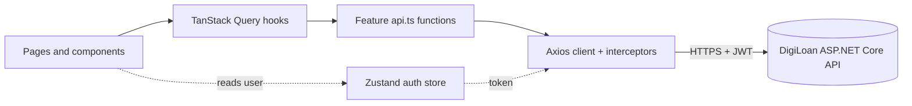
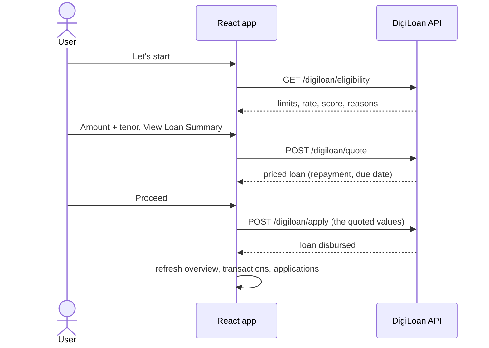

# DigiLoan Web

[](https://react.dev)
[](https://www.typescriptlang.org)
[](https://vite.dev)
[](https://tailwindcss.com)
[](https://tanstack.com/query)

The React + TypeScript frontend for **DigiLoan**, an instant micro-lending app. It reads a customer's last 30 days of account activity, decides whether they qualify for a loan, prices it, and disburses it against a double-entry ledger.

**[Live demo](https://digiloan.vercel.app/login)** · **[Backend repo (ASP.NET Core)](https://github.com/thecoolersuy/digiloan-escrow-ledger)** · **[API docs (Scalar/Swagger)](https://digiloan.runasp.net/scalar/)**

> The demo runs on free hosting in MonsterAsp.Net. If the API has been idle, the first request can take up to a minute while it wakes up. After that it's fast.

## Try it in 30 seconds

No sign-up needed. On the login page:

1. Click **Open Demo As Saver**. You land on a dashboard with 30 days of generated account activity. Go to **Request Loan**, click **Let's start**, and you qualify. Customize an amount and tenor, review the loan summary, and proceed. The loan is disbursed and every screen updates without a reload.
2. Log out, then click **Open Demo As Spender**. Go to **Request Loan** and **Let's start**. You are declined, and the screen lists the reasons.
3. Or register your own account. It starts empty, and one click seeds 30 days of activity as a Saver or a Spender.

The data is synthetic. No real money moves, and the demo accounts reset every time they are opened.

## Features

- **Auth:** register, login, and one-click demo accounts. JWT session, protected routes, and logout that clears all cached data.
- **Overview:** balance, inflow, outflow, and disbursed totals, a 30-day trend chart, and the latest transactions. An empty state guides new users to seed data.
- **Transactions:** server-side pagination and a date-range filter.
- **Request Loan:** an eligibility check with credit score, limit, rate, and tenor, or a clear list of reasons if declined. A customize form validated against the server's limits, a priced loan summary, and a confirmation. A table of your applications shows status, including overdue.
- **Responsive:** the sidebar becomes a drawer on phones, and tables scroll inside themselves.

## Architecture

Every feature follows the same pipeline, and each layer only knows about the one below it:



The loan flow, end to end:



### Where state lives

| Kind of state  | Tool                  | Examples                                               |
| -------------- | --------------------- | ------------------------------------------------------ |
| Server state   | TanStack Query        | overview, transactions, loan applications, eligibility |
| Session        | Zustand (persisted)   | token, email, full name                                |
| Forms          | React Hook Form + Zod | login, register, loan amount and tenor                 |
| Local UI state | `useState`            | loan-flow step, hidden balance, current page           |

### Project structure

```
src/
  api/          axios client, error helper, query keys, cache invalidation
  components/   shared UI: layout, pagination, transactions table, error boundary
  features/     auth · account · seed · dashboard · transactions · loans · errors
  lib/          formatting helpers
  routes/       protected route guard
  stores/       auth store
  types/        TypeScript types mirroring the API's DTOs
```

## Engineering highlights

- **The server owns the numbers.** The loan summary comes from a quote endpoint that shares its code path with the real application, and "Proceed" submits the quoted values, so users are charged exactly what they were shown.
- **One definition of "the account changed."** A single helper refreshes every affected screen after seeding or taking a loan, so no screen can be forgotten.
- **Session safety.** Logout clears the token and the entire query cache, so one user can never see another's data. A `401` only triggers a forced logout when a token existed, so a wrong password shows an error instead of reloading the page.
- **Layered error handling.** The Axios interceptor handles expired sessions, a helper turns the API's `ProblemDetails` into readable messages and tells "server unreachable" from "invalid input", and error boundaries and a 404 route catch render failures.
- **Validation driven by the server.** The loan form's Zod schema is built from the limits the API returns. The server still re-validates everything.
- **Performance.** Route-level code splitting with `React.lazy` and `Suspense` (initial bundle: [X kB → Y kB gzip]), server-side pagination, and no loading flash between pages.

---
